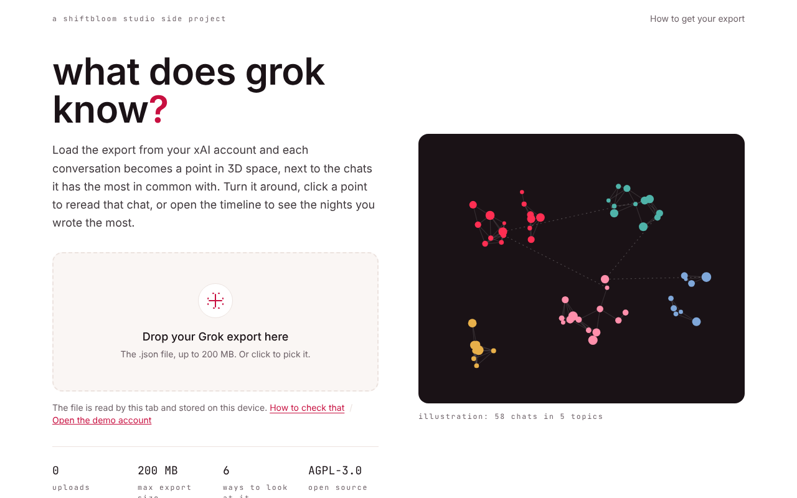
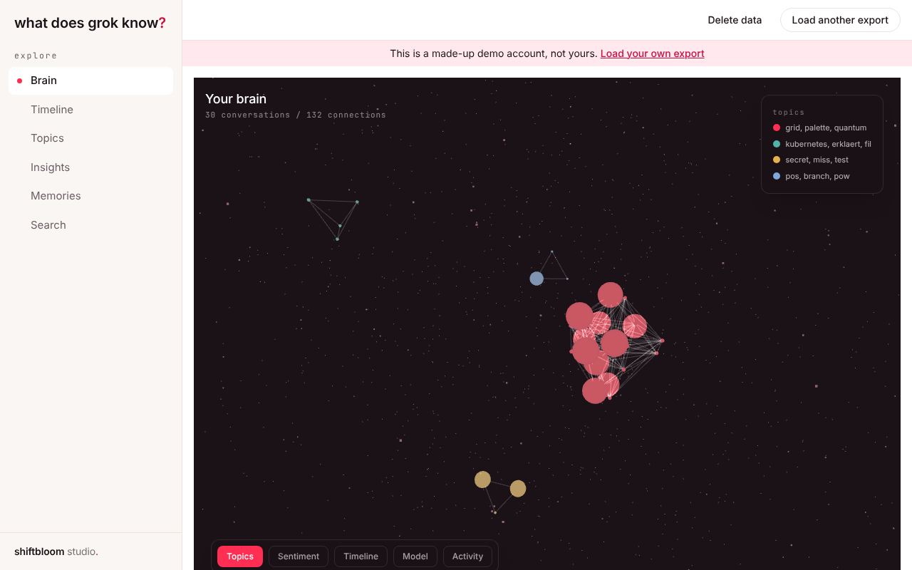
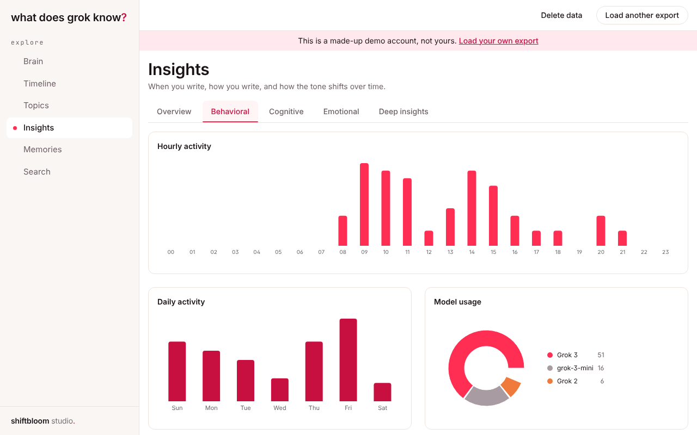

# what does grok know?

Load the conversation export from your xAI account and walk through it as a 3D map. Every chat is a point, chats about similar things sit close together, and around that you get a timeline, a topic list, some statistics about when and how you write, and the facts you mentioned about yourself along the way.

Everything happens in your browser. The export is parsed in a Web Worker, stored in IndexedDB on your device and never sent anywhere. The Content Security Policy only allows network requests to the site's own origin, so the page could not upload your chats even if it tried.

Live at [what-does-grok-know.shiftbloom.studio](https://what-does-grok-know.shiftbloom.studio). Not affiliated with xAI or X.



## Views

| View | What it shows |
| --- | --- |
| Brain | 3D map of all conversations, colored by topic, mood, date, model or activity. Click a point to open the chat. |
| Timeline | Activity heatmap by day and a month-by-month list. |
| Topics | Topic clusters from TF-IDF keywords, with the conversations in each. |
| Insights | Hours and weekdays you write, models used, vocabulary, questions vs. statements, mood over time. |
| Memories | Facts, decisions and lessons pattern-matched from your own messages. |
| Search | Full-text search over every message. |





## Getting your export

Request your data at [accounts.x.ai](https://accounts.x.ai) (or through the X archive if you only used Grok inside X), unzip it and load the JSON file with your conversations. The in-app help page has the details.

## How it works

1. **Parse.** `src/lib/workers/parse-worker.ts` reads the export (MongoDB-style JSON with `conversations` and `responses`) off the main thread.
2. **Store.** Conversations and messages go into IndexedDB via Dexie (`GrokBrainDB`).
3. **Analyse.** `src/lib/workers/analysis-worker.ts` computes topics (TF-IDF clustering), sentiment (word lists), behaviour and writing statistics, and extracts memories. No AI model, no API.
4. **Draw.** The brain view lays the graph out with a force-directed layout and renders it with Three.js through react-three-fiber.

"Delete data" in the header wipes the database.

## Stack

Next.js 16 (static export), React 19, Tailwind CSS 4, Three.js with react-three-fiber, Recharts, Dexie, TypeScript, Biome, Vitest. Hosted as a Cloudflare Worker with static assets.

## Development

Requires Node.js 20.9 or newer.

```sh
npm install
npm run dev          # http://localhost:3000
npm test
npm run lint
npm run type-check
npm run build        # static site in out/
```

`npm run preview` builds the site and serves it through the Worker with `wrangler dev` on http://localhost:8787, including the legal pages and the font proxy. Copy `.dev.vars.example` to `.dev.vars` first.

## Self-hosting on Cloudflare

The production build is a plain static site in `out/`. A small Worker (`worker/index.ts`) sits in front of it for three things:

- `/privacy`, `/datenschutz`, `/imprint`, `/impressum`: the privacy policy and legal notice in English and German, rendered from the `LEGAL` secret. They return 404 while it is unset.
- `/fonts/*`: Clash Display and General Sans, fetched from Fontshare by the Worker and served from your own origin, so visitors' browsers never contact a font CDN.
- Security headers on those responses. Static files get the same headers from `public/_headers`.

To deploy your own copy:

1. Fork the repository and run `npx wrangler login`, or connect the repository in the Cloudflare dashboard (Workers & Pages, Create, Import a repository) with build command `npm run build` and deploy command `npx wrangler deploy`.
2. Set the operator details for the legal pages as a secret. They stay out of the repository and survive redeploys.

   ```sh
   npx wrangler secret put LEGAL
   ```

   The value is JSON in this shape (`business`, `phone` and `vatId` are optional):

   ```json
   {
     "name": "Jane Doe",
     "business": "Example Studio",
     "street": "Example Street 1",
     "city": "12345 Example Town",
     "country": { "en": "Germany", "de": "Deutschland" },
     "email": "hello@example.com",
     "authority": "Name and address of your data protection supervisory authority"
   }
   ```

3. Attach a custom domain to the Worker (Settings, Domains & Routes). `wrangler.jsonc` deliberately has no routes, and `workers.dev` is off.
4. Set `NEXT_PUBLIC_SITE_URL` at build time to your domain so canonical URLs, the sitemap and Open Graph tags point to it, and update `public/robots.txt`.

The legal texts in `worker/legal.ts` were written for an operator in Germany. Check them against your own situation before you publish.

## Design

The UI follows the shiftbloom brandbook v2: white surfaces, Bloom Red `#FF2E52` for actions and the question-mark seed, Root Red `#C81040` for small red text and links, Clash Display for headlines, General Sans for UI and body, JetBrains Mono for labels and numbers. No gradients outside the logo mark. The 3D canvas sits on Ink `#1A1216`.

## Contributing

See [CONTRIBUTING.md](CONTRIBUTING.md). Security issues go through [SECURITY.md](SECURITY.md).

## License

[AGPL-3.0-or-later](LICENSE). If you run a modified version for others, you have to offer them its source code. The footer of the app links to this repository for that reason.

Made by [shiftbloom studio](https://shiftbloom.studio).
